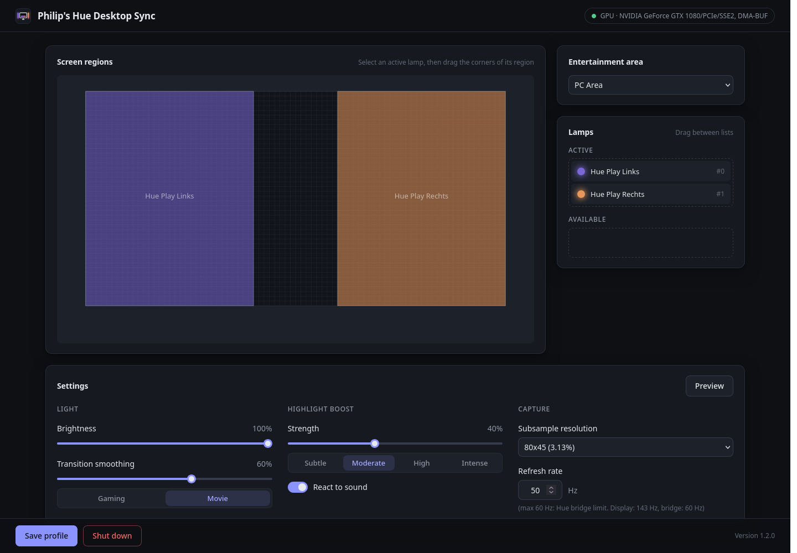

# Lightspill

Screen and sound sync for Philips Hue lamps on Linux

<p align="center">
  
</p>

[Deutsche Version](README.de.md)

Lightspill lets your Philips Hue lamps follow your screen in real time, like the official Hue Sync app does on Windows and macOS. Lamps flash with bright scenes and, optionally, with the sound of your computer. When you don't want them to follow the screen, they show static colors and scenes instead.

It is a fork of [Huenicorn](https://gitlab.com/openjowelsofts/huenicorn) by OpenJowel. See [Origin and changes](#origin-and-changes).

|  |
|:--:|
| *The light manager* |

> Lightspill is an independent project. It is not affiliated with, endorsed or sponsored by Signify or Philips. Philips Hue and Hue Sync are trademarks of Signify Holding.

## Features

* **Screen sync**: each lamp follows the screen region you assign to it, at up to 60 Hz through the Hue Entertainment API
* **GPU capture**: frames stay in video memory (DMA-BUF) and the lamp colors are computed on the GPU, with an automatic CPU fallback
* **Highlight boost**: lamps flash brighter on sudden bright moments (explosions, lightning), optionally on loud moments of the computer's sound too
* **Static scenes**: one color for all lamps, a color per lamp, built-in scenes or your own saved ones, switched with one click
* **Preview**: a 12 second test sequence to tune smoothing, brightness and highlight boost
* **Desktop application**: a window and a tray icon instead of a browser tab, with a setup wizard that pairs with the bridge
* **English and German**, following the system language

## Requirements

* Linux with a **Wayland** session and Pipewire. X11 is not supported
* An xdg-desktop-portal with screen casting: KDE Plasma, GNOME, Hyprland, Sway and other wlroots compositors provide one
* A Philips Hue bridge (v2 or Pro) with an **entertainment area**, set up in the Hue app
* For the desktop application: Qt 6 with Qt WebEngine. The tray icon needs a desktop with a system tray

### Tested on

Lightspill is developed and tested on CachyOS with KDE Plasma (Wayland) and an NVIDIA GPU (proprietary driver). The GPU path only uses vendor-neutral EGL extensions and should work with AMD and Intel GPUs (Mesa), but this hasn't been tested yet. Without a usable GPU, frames are processed on the CPU. Reports about other setups are welcome.

## Installation

### Arch Linux and derivatives (CachyOS, EndeavourOS, Manjaro…)

`dist/arch/PKGBUILD` builds and installs a package:

```bash
git clone https://github.com/derPhili/lightspill.git
cd lightspill/dist/arch
makepkg -si
systemctl --user enable --now lightspill.service
```

The package contains:

* `lightspill`: the service driving the lamps, with its systemd user unit
* `lightspill-gui`: the desktop application, in the application menu as "Lightspill"
* an autostart entry starting the tray icon at login

### Building from source

Dependencies on Arch based distributions:

```bash
sudo pacman -S git cmake make gcc pkgconf curl opencv mbedtls pipewire glib2 nlohmann-json glm libglvnd libdrm qt6-base qt6-svg qt6-webengine
```

Lightspill needs **Mbed TLS 4.x** and **[cpp-httplib](https://github.com/yhirose/cpp-httplib) 0.46 or newer**. If your distribution ships older versions, build them from source. For cpp-httplib:

```bash
git clone --branch v0.46.0 https://github.com/yhirose/cpp-httplib.git
cmake -S cpp-httplib -B cpp-httplib/build
sudo cmake --install cpp-httplib/build
```

Then build Lightspill:

```bash
git clone https://github.com/derPhili/lightspill.git
cd lightspill
cmake -S . -B build -DCMAKE_INSTALL_PREFIX=/usr
cmake --build build -j
sudo cmake --install build
```

Options:

* `-DBUILD_GUI=OFF` builds without the desktop application (no Qt needed). The light manager is then used in a browser at [127.0.0.1:8215](http://127.0.0.1:8215)
* `-DBUILD_TESTS=ON` builds the tests, run with `ctest --test-dir build`. `TestGpuDownscale` sends a known image through the GPU as a DMA-BUF and compares it with the exact CPU average; it needs `mesa` for `libgbm`

## Usage

### First start

Start "Lightspill" from the application menu. As long as no bridge is paired, a setup wizard guides you through:

1. **Finding the bridge**: it is searched automatically (through the Philips discovery service, which needs internet access), or you enter its IP address
2. **Pairing**: press the round button on top of the bridge. The app retries every 2 seconds and pairs as soon as the button is pressed
3. **Entertainment area**: the wizard checks that one exists and explains how to create it in the Hue app otherwise
4. **Screen selection**: the desktop asks which screen Lightspill may capture. Allow it to be remembered, so you aren't asked again on every start

Then, in the light manager, drag your lamps from "Available" to "Active", select a lamp to adjust the screen region it follows, and save the profile.

### Desktop application and service

The lamps are driven by a service (systemd user unit `lightspill.service`). The desktop application shows its user interface:

* Left click on the tray icon: open or close the window
* Right click: sync on/off, static scenes, preview, start the service if it isn't running

Closing the window keeps the tray icon. Closing the tray icon keeps the lamps running: only the service drives them. Starting the application again brings the running window to the front.

On desktops without a system tray (GNOME needs an extension such as AppIndicator), closing the window quits the application, and the tray started at login gives up after 30 seconds. The lamps keep running in both cases.

Logs of the service:

```bash
journalctl --user -u lightspill.service -f
```

### Light manager

* **Screen regions**: the part of the screen each active lamp follows, with a gamma correction per lamp
* **Sync** (header): switches between following the screen and showing the static scene. Without sync, screen capture and sound analysis pause
* **Static scene**: one color for all lamps, a color per lamp, built-in scenes whose colors are spread over the lamps from left to right, and your own saved scenes. Picking one turns sync off
* **Settings**: brightness, transition smoothing (presets "Gaming" and "Movie"), highlight boost (presets from "Subtle" to "Intense"), reacting to sound, capture resolution and refresh rate
* **Preview**: plays color cuts, flashes left, right and on both sides, a slow fade and a cut from black to white through the current settings

Every control explains itself in a tooltip.

### GPU processing

The compositor delivers frames as DMA-BUF in video memory. Lightspill imports them through EGL without copying and computes the lamp colors on the GPU: a shader averages the frame down to the subsample resolution, two more passes average each lamp's region, and only one pixel per lamp is read back. The log shows the active path:

```
[gpu] Using EGL device /dev/dri/renderD128 (NVIDIA)
Capture path: GPU (DMA-BUF, modifier 0x0)
```

If the import fails, Lightspill falls back to shared memory and the CPU (`Capture path: CPU (shared memory)`). `LIGHTSPILL_DISABLE_GPU=1` forces the CPU path, for example to compare.

## Configuration

The configuration lives in `~/.config/lightspill/`. A configuration of Huenicorn or of a former name of Lightspill is taken over on the first start.

* `config.json`: bridge, credentials and settings
* `profile.json`: the lamps' screen regions for an entertainment area

### config.json

Most values are changed from the light manager. All of them can be edited by hand while Lightspill isn't running.

* **boundBackendIP**: (string) address the light manager listens on. Default `127.0.0.1` (local access only). With `0.0.0.0` it's reachable from other devices, without any authentication
* **bridgeAddress**: (string) address of the Hue bridge
* **credentials**: **username** and **clientkey** (strings) created when pairing
* **profileName**: (string) name of the lamp profile
* **refreshRate**: (unsigned) capture and streaming rate. At most 60 Hz: the bridge forwards colors to the lamps at about 25 Hz and Philips recommends streaming at 50–60 Hz
* **restoreToken**: (string) remembers the screen selection
* **restServerPort**: (unsigned) port of the light manager, 8215 by default
* **subsampleWidth**: (unsigned) width of the downscaled frame the regions are averaged on
* **brightness**: (float) brightness of all lamps, from 0 to 1
* **transitionSmoothing**: (float) how softly lamps move to a new color, from 0 (instant) to 0.97
* **highlightBoost**: (float) strength of the flashes on sudden brightening, from 0 (off) to 1. A rise of the unsmoothed brightness of a lamp's region above 5% from one frame to the next triggers it, fully from 30%; it fades with a time constant of 250 ms
* **audioReactive**: (boolean) whether loud moments of the computer's sound trigger the highlight boost too. Lightspill listens to the monitor of the default output through Pipewire (no microphone). A buffer more than 6 dB above the average of the last 0.5 s triggers, fully from 12 dB; sound below −50 dBFS never does. The left and right channels are spread over the lamps by their position
* **syncEnabled**: (boolean) whether the lamps follow the screen or show the static colors
* **staticColors**: (object) static color per channel ID, as `#rrggbb`
* **scenes**: (object) saved scenes: name → colors as in `staticColors`
* **language**: (string) `auto` (system language, English if it's neither German nor English), `en` or `de`

### profile.json

* **entertainmentConfigurationId**: (string) UUID of the entertainment area
* **channels**: (array) the lamps of the area, each with **channelId**, **active**, **devices**, **gammaFactor** and **uvs** (top left **uvA** and bottom right **uvB** corner of its screen region, from 0 to 1)

## Troubleshooting

### No entertainment area is shown

The credentials may have become invalid. Stop Lightspill, delete `~/.config/lightspill/config.json` and start it again: the setup wizard pairs with the bridge again.

### Choosing another screen

Stop Lightspill, remove the `restoreToken` line from `~/.config/lightspill/config.json` and start it again: the desktop asks for the screen again.

### The lamps don't react

* Another application may be streaming to the entertainment area (the Hue app or Hue Sync on another computer): the bridge accepts one stream at a time. Lightspill retries every 5 seconds
* Check the log with `journalctl --user -u lightspill.service`

## Origin and changes

Lightspill is a fork of [Huenicorn](https://gitlab.com/openjowelsofts/huenicorn) 1.2.0 by OpenJowel and its contributors, whose history it keeps. The main changes since the fork:

* Frames are processed on the GPU from DMA-BUFs, with the CPU as fallback; the CPU load dropped from about 45% to about 3% of a core
* Highlight boost from the picture and the sound, brightness, smoothing presets, static colors and scenes, preview sequence
* Desktop application with tray icon, setup wizard, new user interface, German translation
* Streaming capped to what the bridge processes, connection handled in the background, many fixes
* Support for X11, other platforms and the CPU interpolation modes was removed to keep the code focused

## License

Lightspill is free software under the GNU General Public License version 3, like Huenicorn. See [LICENSE.txt](LICENSE.txt). You may use, study, share and modify it; modified versions you distribute must be under the same license, with their source code.

## Acknowledgments

* [Huenicorn](https://gitlab.com/openjowelsofts/huenicorn) by OpenJowel and its contributors
* [XDG portal screencast example](https://codeberg.org/metamuffin/xdg-dp-start/src/branch/master/xdg-dp-start.c)
* [Pipewire documentation](https://docs.pipewire.org/page_tutorial5.html)
* [RGB to xy (D65) conversion](https://gist.github.com/popcorn245/30afa0f98eea1c2fd34d)
* [Huestacean](https://github.com/BradyBrenot/huestacean)
